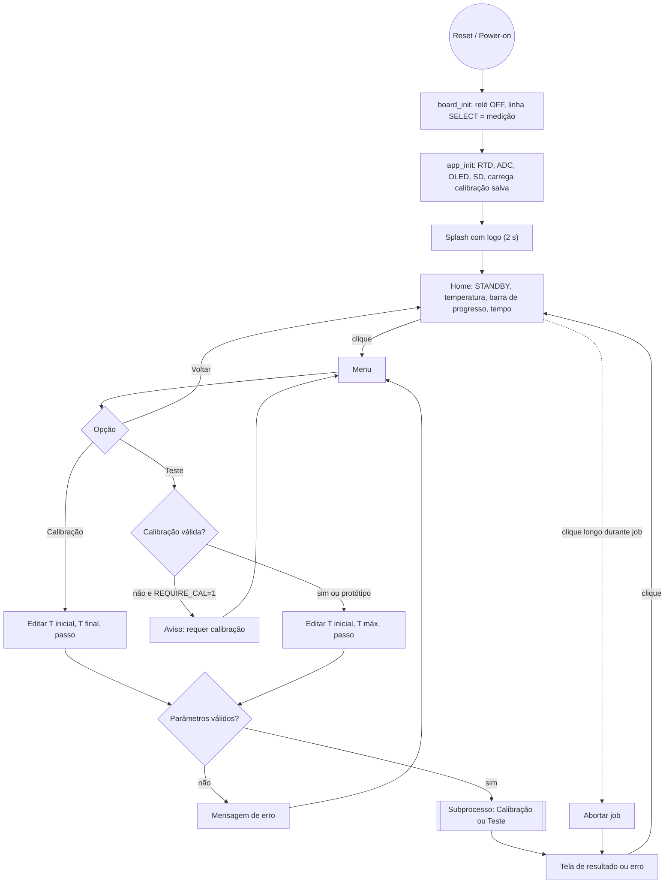
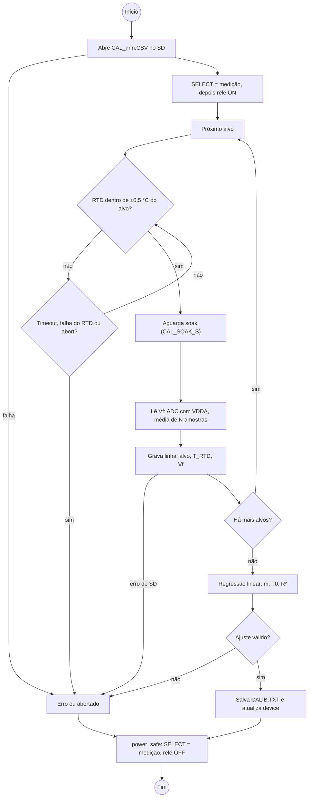
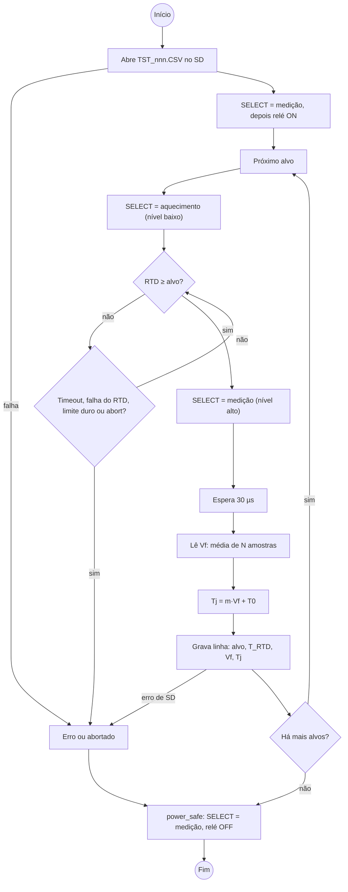

# Control-Device-Electral-Method

Firmware: [build and test instructions](fw/Control_Device_Electral_Method/BUILDING.md) · [SD diagnosis and resolution](fw/Control_Device_Electral_Method/SD_WRITE_FIX.md).

# Arquitetura do Firmware — Caracterizador Térmico (STM32F407VET6)

referências: Kauê Lucas (diagrama "Thermal Hardware Architecture", 08/10/2026).
Base teórica: Sofia, *Fundamentals of Thermal Resistance Measurement* (1995), método elétrico (Vf como TSP).

## 1. Princípios

1. **`main.c` só chama funções**: `board_init(); app_init(); for (;;) app_run();`
2. **Hardware escondido atrás de headers de driver.** Só `board/` conhece pinos e HAL. Lógica (`core/`) e IHM (`ui/`) nunca incluem `stm32f4xx_hal.h`.
3. **O header do driver é a interface.** No PC os testes linkam *fakes* com o mesmo header; no alvo linka-se o driver real.
4. **A IHM é só consumidora.** `ui/` lê o estado (`device.h`) e devolve comandos (`ui_cmd_t`); quem inicia calibração ou teste é o `app.c`.
5. **Segurança primeiro.** Todo caminho de saída (fim, erro, abort) passa por `power_safe()`: linha SELECT em medição e relé desligado.
6. **Super-loop cooperativo, sem RTOS.** Cada módulo tem um `*_step()` não bloqueante. A única janela bloqueante é a medição do teste (30 µs + leitura do ADC, dezenas de µs).

## 2. Diagrama de hardware → drivers

| Bloco do diagrama | Periférico | Pinos (PROPOSTOS, conferir esquemático) | Driver |
|---|---|---|---|
| Regulation and Protection / relé | GPIO saída | `RELAY_EN` PE0 (pull-down externo, nível baixo no reset) | `power` |
| Control Driver/Gate → MOSFET SI2307 | GPIO saída | `CUR_SEL` PE1 (alto = medição, baixo = aquecimento) | `power` |
| MAX31865 + PT100 | SPI1 modo 1 | SCK PA5, MISO PA6, MOSI PA7, CS PA4 (GPIO) | `rtd` |
| Vf do DUT | ADC1 IN10 + VREFINT (canal 17) | PC0 | `vf_adc` |
| Display OLED 1.3" | I2C1 400 kHz, end. 0x3C | SCL PB8, SDA PB9 | `oled` (u8g2) |
| Rotary Encoder | TIM2 modo encoder + GPIO botão | A PA0, B PA1, SW PE2 (pull-up) | `encoder` |
| SD Card | SDIO 4 bits + FatFs | D0..D3 PC8..PC11, CK PC12, CMD PD2 | `sdlog` |
| Delay de µs | DWT->CYCCNT | — | `board_delay_us` |
| Clock | HSE 8 MHz, PLL 168 MHz, PCLK2 84 MHz (ADC a 21 MHz) | — | `board` |

## 3. Árvore de arquivos

```
firmware/
├── Makefile                  # arm-none-eabi-gcc (gerado pelo CubeMX e ajustado)
├── thermal.ioc               # CubeMX: pinos, clocks, periféricos (main NÃO gerado)
├── main.c                    # somente chamadas
├── config.h                  # TODAS as constantes ajustáveis
├── app.c / app.h             # orquestra: leitura periódica, UI, jobs
├── board/    board.c/.h      # init de clock e periféricos, board_millis, board_delay_us
├── drivers/
│   ├── power.c/.h            # relé + linha SELECT
│   ├── rtd.c/.h              # MAX31865 (SPI)
│   ├── vf_adc.c/.h           # ADC do Vf + VDDA por VREFINT
│   ├── sdlog.c/.h            # FatFs: CSV de execução + arquivo de calibração
│   ├── oled.c/.h             # SH1106 128x64 via u8g2
│   └── encoder.c/.h          # eventos CW/CCW/CLICK/LONG
├── core/                     # lógica pura, sem HAL
│   ├── device.c/.h           # estado único lido pela UI
│   ├── job.h                 # interface comum calibração/teste
│   ├── calibration.c/.h      # job de calibração
│   ├── heattest.c/.h         # job de teste
│   ├── targets.c/.h          # gera a lista de temperaturas-alvo
│   ├── linfit.c/.h           # regressão linear (m, T0, R²)
│   ├── rtd_math.c/.h         # contagens MAX31865 → ohm → °C
│   └── vf_math.c/.h          # contagens ADC → volts, VDDA
├── ui/
│   ├── ui.c/.h               # máquina de telas, devolve ui_cmd_t
│   ├── ui_nav.c/.h           # navegação/edição pura (testável no PC)
│   ├── screens.c/.h          # desenho das telas
│   └── logo.h                # bitmap da logo
└── tests/                    # host (gcc + Unity)
    ├── Makefile
    ├── vendor/unity/
    ├── fakes/fake_hw.c       # board, power, rtd, vf_adc, sdlog falsos
    └── test_*.c
```

Regra de dependência: `app → ui, core, drivers`; `ui → core/device, drivers/oled|encoder` (apenas via `screens`); `core → drivers (headers)`; `drivers → board`; `board → HAL`. `core/` nunca inclui `ui/` nem HAL.

## 4. Modelo de execução

```c
int main(void) { board_init(); app_init(); for (;;) { app_run(); } }
```

`app_run()` a cada passada: (1) a cada 250 ms lê o RTD e atualiza `device`; (2) lê o evento do encoder e chama `ui_step()`; (3) trata o `ui_cmd_t` devolvido (iniciar/abortar job); (4) chama `step()` do job ativo; (5) renderiza a UI a cada 100 ms.

## 5. Diagramas BPMN

Os fluxos abaixo seguem a notação BPMN (eventos de início/fim em círculo, gateways em losango, subprocesso em caixa dupla), em Mermaid para renderizar direto no Markdown.

### 5.1 Ciclo de vida e IHM



### 5.2 Subprocesso: Calibração



### 5.3 Subprocesso: Teste



## 6. Formatos de arquivo no SD

- `CAL_nnn.CSV`: `idx,t_alvo_c,t_rtd_c,vf_v`
- `TST_nnn.CSV`: `idx,t_alvo_c,t_rtd_c,vf_v,tj_c,t_s` (`tj_c` = `NaN` se não houver calibração)
- `CALIB.TXT`: `m,t0,r2,n` (última calibração válida, recarregada no boot)

## 7. Premissas a confirmar

1. **Sensor**: o diagrama mostra PT100 + MAX31865; o texto fala em "termopar". O plano segue o diagrama (RTD).
2. **Encoder**: o diagrama o liga por I2C; o plano usa TIM2 em modo encoder (sem barramento). Trocar é local ao `encoder.c`.
3. **SD**: o diagrama não diz o barramento; o plano usa SDIO 4 bits.
4. **OLED 1.3"**: normalmente SH1106 (não SSD1306). A escolha é uma linha em `oled.c`.
5. **Rref do MAX31865**: 430 Ω (módulo padrão para PT100), em `config.h`.
6. **"Chegou na temperatura alvo" no teste** é decidido pela leitura do RTD (temperatura do case). `Tj` é calculada de `Vf` e registrada junto.
7. **Resolução do Vf**: ADC de 12 bits em 3,3 V dá ≈0,8 mV/LSB, ou ≈0,29 °C/LSB com a inclinação de 357 °C/V do exemplo do artigo. A média de amostras ajuda, mas o piso de ruído é do ADC interno.
8. **30 µs de atraso**: o artigo cita 0 a 500 µs para os transientes elétricos, mais longos em junções grandes. O valor fica em `TEST_MEAS_DELAY_US` para ajuste em bancada.
